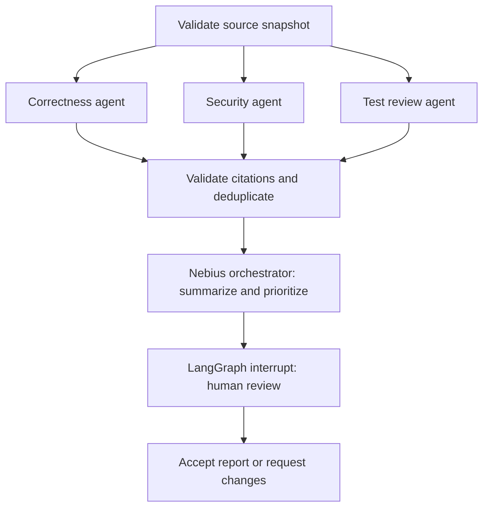

# Project 3E: Code Review Agent

A Streamlit workspace backed by a real LangGraph multi-agent workflow. Three agents inspect correctness, security, and test gaps in parallel. An LLM orchestrator combines source-validated findings into a severity-ranked report, then LangGraph pauses for a human decision.

All AI agents use **Nebius Token Factory**, the OpenAI Python SDK, and **`nvidia/Nemotron-3_5-Lightning`** at `https://api.tokenfactory.eu-north1.nebius.com/v1/`.

For this model, requests set `extra_body={"chat_template_kwargs": {"enable_thinking": false}}`, the documented direct-output control. This reserves the output budget for tool calls and structured review findings.

## Run in this workspace

```bash
cd /Users/harshitha/Documents/Master_Agentic_AI/week_3_project
source .venv/bin/activate
python -m streamlit run streamlit_app.py
```

Open **http://127.0.0.1:8503**. The supplied `nebius-api-key.rtf` is read locally when `NEBIUS_API_KEY` is unset. The key is never copied into application source or reports. Environment variables take precedence over `.env`, then the supplied RTF file. `.gitignore` excludes all three credential locations.

You can also launch the installed workspace with `./run.sh`.

For a fresh installation, use Python 3.11–3.14:

```bash
python3 -m venv .venv
source .venv/bin/activate
python -m pip install -e '.[dev]'
# Optional: copy .env.example to .env and set NEBIUS_API_KEY.
python -m streamlit run streamlit_app.py
```

The UI has a sample library, source editor, multi-file uploads, severity/agent filters, source excerpts, individual agent assessments, workflow trace, human decision controls, and Markdown/JSON exports. All downloads are local user actions. Changing filters or tabs does not rerun the model.

`requirements.lock` records the exact validated versions. To reproduce the environment, install it first with `python -m pip install -r requirements.lock`, then `python -m pip install --no-deps -e .`.

## Workflow



Each specialist first calls the LangChain `inspect_sources` tool through native model tool calling. It can then call `read_lines` and `search_sources` before producing schema-validated JSON. Tools only read the submitted snapshot; Python analysis uses `ast.parse`, never source execution. The testing agent uses the submitted test inventory and cannot measure runtime coverage. Non-Python languages receive model review and test inventory without Python AST heuristics.

The orchestrator cannot introduce new findings. Every finding must name an existing file and valid, nonblank 1-based source line range. The application attaches the actual source excerpt from that range, replacing model-supplied quotes. This validates source locations; whether a claim describes a real defect still needs human verification. Similar findings at overlapping locations are merged with agent attribution. Severity ordering is deterministic; the LLM can reorder only within a severity. Missing tests alone are capped at medium severity.

## Failure handling and memory

- Connection errors, timeouts, HTTP 429 and server errors get at most two transport attempts. Authentication and invalid requests fail immediately with sanitized messages.
- Each specialist has three tool rounds, six tool invocations, and one final structured-output repair. Invalid citations fail the specialist instead of becoming unsupported findings.
- A failed specialist yields an explicitly incomplete report. Orchestrator failure uses deterministic ranking and marks the report incomplete. Incomplete reports cannot be accepted.
- Each browser session owns an `InMemorySaver` checkpointer and model client. State includes the source snapshot, specialist results, report and trace; it survives Streamlit reruns and interrupt/resume within that session, and is lost on process restart or session reset. It is not durable cross-session storage.
- Human decisions use `interrupt()` and `Command(resume=...)`. Accepting a report acknowledges the assessment; it does not approve, merge, or modify the reviewed code. Requesting changes records feedback; rerunning is an explicit new review.

Only the selected code is transmitted to Nebius for review. Code comments and tool output are treated as untrusted data in agent prompts. The app neither runs uploaded code nor applies fixes. It binds to localhost by default.

## CLI and validation

```bash
python -m code_review samples
python -m code_review review path/to/source.py path/to/test_source.py --output .review-data/my-review
python -m code_review evaluate --output reports
python -m pytest -q
```

`review` produces a draft. After inspecting an exported report, use `python -m code_review decide .review-data/my-review.json --decision accepted` or `--decision changes_requested --notes '...'` to record your decision. Live browser sessions use LangGraph interrupt/resume; the CLI `decide` command updates the explicitly selected export. Draft exports are clearly labeled pending. The evaluation command performs live Nebius reviews of three attributed open-source snapshots and writes one JSON and Markdown report per sample plus an evaluation summary. It does not execute their code or tests.

See `examples/real_samples.json` for source URLs, pinned release refs, checksums and licenses. `examples/demo/` contains a separate intentionally flawed synthetic example for demonstration and is never represented as real open-source code. Saved reports identify the model, completeness, source hashes, timing, usage, and approval state. Results are model assessments, not verified upstream vulnerability disclosures.

The validated run passed **30 automated tests** and completed **3/3 real sample reviews** with all specialist agents and synthesis succeeding. See `reports/evaluation.md` for measured timings and completion scope.

## Project handoff

`docs/PROJECT_DOCUMENTATION.md` maps the implementation to the handout and supplies a project overview, agent framework, iteration notes and a five-minute demo script. The handout also requests a Google Doc, a recorded demo and a GitHub link; those account-owned submission steps are not created automatically by this local project.

The sanitized source archive is `dist/project_3e_code_review_agent.zip`. Rebuild it with `python scripts/package_project.py`; the archive excludes the supplied API key, local secrets, virtual environments and session data. Recipients must configure their own `NEBIUS_API_KEY` before running the project.

Implementation references: [LangGraph graph API](https://docs.langchain.com/oss/python/langgraph/graph-api), [LangGraph interrupts](https://docs.langchain.com/oss/python/langgraph/interrupts), [Streamlit testing](https://docs.streamlit.io/develop/api-reference/app-testing/st.testing.v1.apptest), and [Nebius Nemotron models](https://nebius.com/services/token-factory/models/nvidia-nemotron-models-inference).
